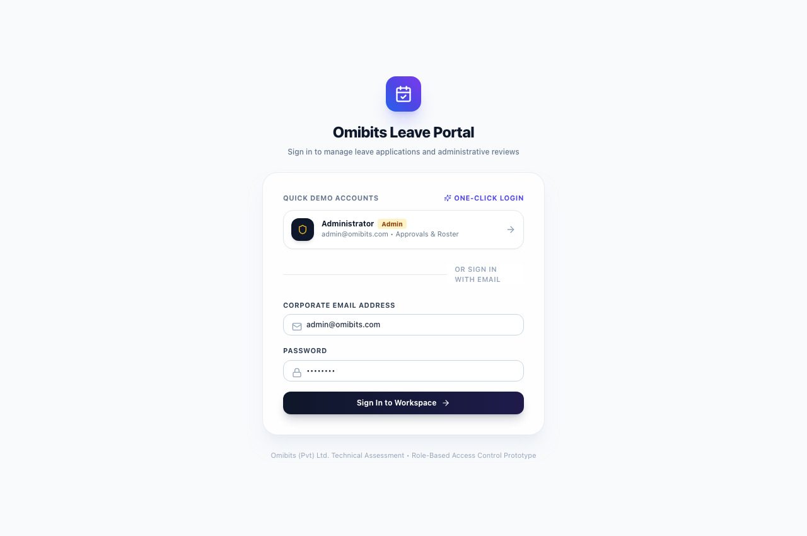
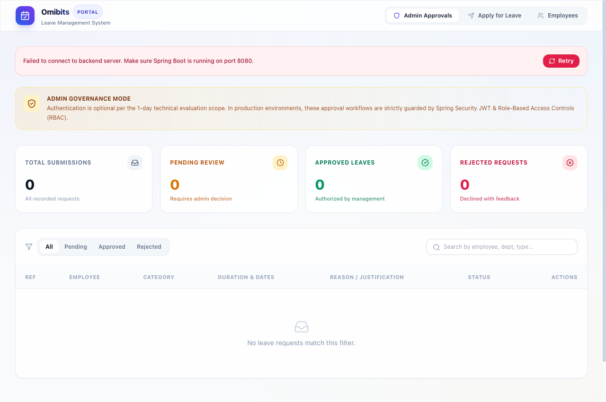
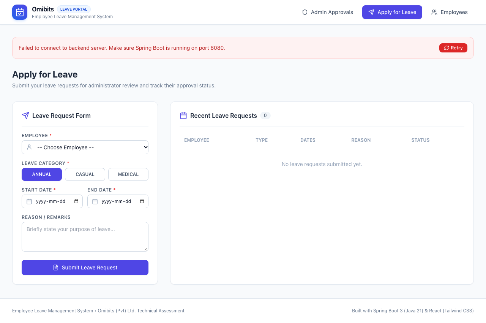
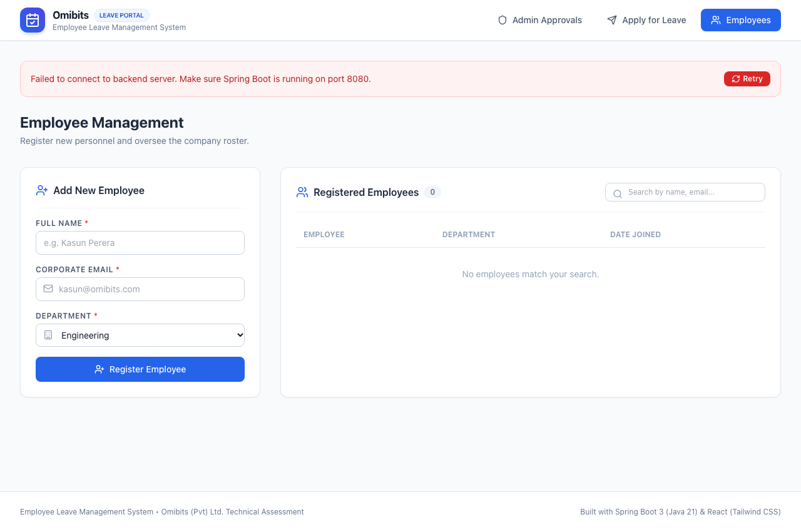
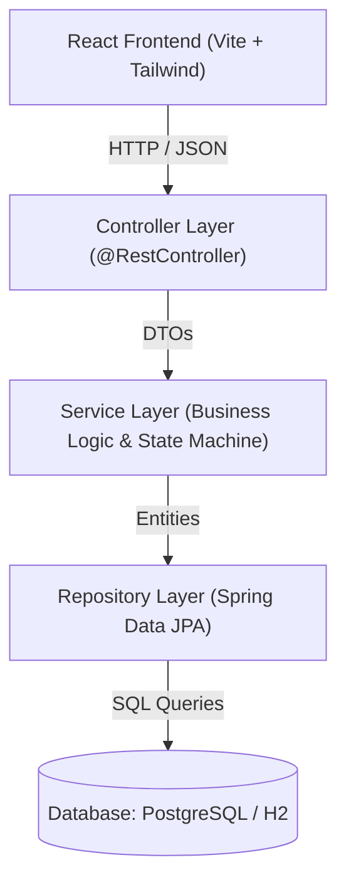
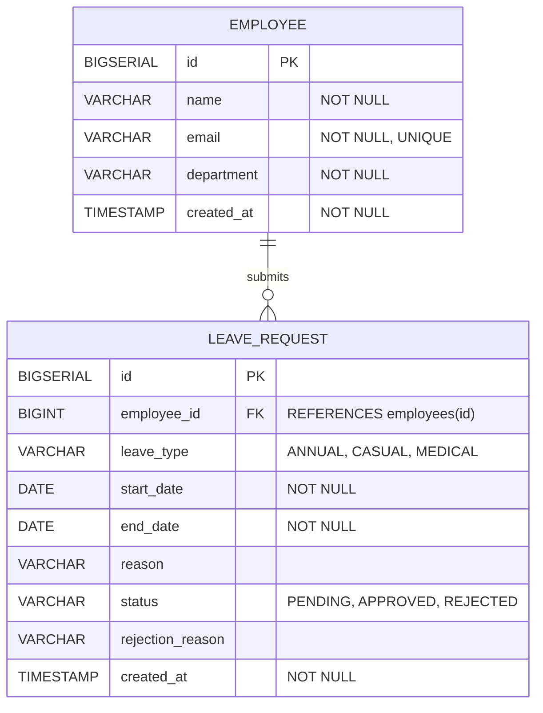

# Employee Leave Management System

A full-stack, enterprise-grade web application designed for managing employee leave applications and administrative workflows. Built as part of the Software Engineering Intern Technical Assessment for **Omibits (Pvt) Ltd.**

- **Repository:** `intern-leave-management-assignme`
- **Candidate:** Deshan Siriwardhana
- **Role:** Software Engineering Intern

---

## 🚀 Tech Stack

| Layer | Technologies | Justification |
| :--- | :--- | :--- |
| **Backend** | Java 21, Spring Boot 3.3.5 | Industry standard for enterprise REST APIs, strong type safety, Spring Data JPA, Jakarta Bean Validation. |
| **Frontend** | React 18, Vite, Tailwind CSS, Lucide Icons, Axios | Fast reactive Single Page Application (SPA), responsive UI, instantaneous client-side validation. |
| **Database** | PostgreSQL / H2 In-Memory RDBMS | Relational integrity with foreign key cascading and check constraints; zero-friction local execution with H2. |
| **Testing** | JUnit 5, Mockito | High code quality and coverage for critical business rules and state machines. |

---

## 📸 Application Screenshots

### 1. Workspace Sign-In & Role Selector
Interactive portal login featuring 1-click demo accounts (Administrator vs. Registered Employees) as well as corporate credentials.


### 2. Administrator Dashboard & Approvals
Overview metrics, pending review queue, quick approvals, and status filters.


### 3. Leave Application Form
Interactive leave application with real-time date duration calculation and date range error prevention.


### 4. Employee Roster & Registration
Employee creation form with instant email validation and department tagging alongside real-time directory.


---

## 🏛️ System Architecture

The application adopts a clean **Layered Architecture (Tiered Architecture)** ensuring complete separation of concerns:



- **Controller Layer (`controller/`)**: Responsible solely for HTTP mapping, payload reception, invoking validation, and formatting standard JSON responses.
- **Service Layer (`service/`)**: Houses all business rules, date logic, state transition constraints, and entity transformations.
- **Repository Layer (`repository/`)**: Encapsulates database operations using Spring Data JPA.
- **DTO Layer (`dto/`)**: Decouples internal database entities from external API contracts to avoid over-exposure.
- **Exception Layer (`exception/`)**: Centralized `@RestControllerAdvice` converting exceptions into unified JSON error bodies (`ErrorResponse`).

---

## 🗄️ Database Design & Entity Relationships

The relational model enforces a strict **One-to-Many (1:N)** relationship between `Employee` and `LeaveRequest`.

### Entity-Relationship Diagram



The exact SQL schema definition with check constraints and indexes is available in [`database/schema.sql`](database/schema.sql).

---

## 📋 REST API Endpoints

All endpoints use standard HTTP verbs and status codes:

| Method | Endpoint | Description | Request Body | Response Code |
| :--- | :--- | :--- | :--- | :--- |
| `POST` | `/api/employees` | Register new employee | `EmployeeRequest` JSON | `201 Created` |
| `GET` | `/api/employees` | List all employees | None | `200 OK` |
| `GET` | `/api/employees/{id}` | Get employee by ID | None | `200 OK` |
| `POST` | `/api/leaves` | Submit leave request | `LeaveApplicationRequest` JSON | `201 Created` |
| `GET` | `/api/leaves` | List all leave requests | None | `200 OK` |
| `GET` | `/api/leaves/{id}` | Get leave request by ID | None | `200 OK` |
| `PATCH` | `/api/leaves/{id}/approve` | Approve leave request | None | `200 OK` |
| `PATCH` | `/api/leaves/{id}/reject` | Reject leave request | `RejectLeaveRequest` JSON | `200 OK` |

---

## 🔍 API Usage & Example Requests

### 1. Register Employee
```bash
curl -X POST http://localhost:8080/api/employees \
  -H "Content-Type: application/json" \
  -d '{
    "name": "Kamal Wickramasinghe",
    "email": "kamal@omibits.com",
    "department": "Engineering"
  }'
```

### 2. Submit Leave Request
```bash
curl -X POST http://localhost:8080/api/leaves \
  -H "Content-Type: application/json" \
  -d '{
    "employeeId": 1,
    "leaveType": "ANNUAL",
    "startDate": "2026-11-01",
    "endDate": "2026-11-05",
    "reason": "Family vacation"
  }'
```

### 3. Approve Request
```bash
curl -X PATCH http://localhost:8080/api/leaves/1/approve
```

### 4. Reject Request (Requires Rejection Reason)
```bash
curl -X PATCH http://localhost:8080/api/leaves/1/reject \
  -H "Content-Type: application/json" \
  -d '{
    "rejectionReason": "Project sprint deadline falls within this date window."
  }'
```

---

## 🧪 Unit & Integration Testing

The project contains unit tests implemented using **JUnit 5** and **Mockito** covering the required business constraints:

1. **Email Duplicate Prevention:** Tests that attempting to register an employee with an existing email throws `InvalidOperationException`.
2. **Date Range Validation:** Tests that `endDate < startDate` fails with a descriptive validation exception.
3. **State Transition Integrity:** Tests that only `PENDING` leaves can be approved or rejected.
4. **Finalized Immutability:** Tests that already `APPROVED` or `REJECTED` requests cannot be altered.
5. **Mandatory Rejection Justification:** Tests that rejecting without a reason fails.

### Running Backend Tests:
```bash
cd backend
./mvnw test
```

---

## 💻 Local Setup & Execution Guide

### Prerequisites
- **Java 21** or later (`java -version`)
- **Node.js 18+** & npm (`node -v`, `npm -v`)
- Git

### 1. Clone the Repository
```bash
git clone https://github.com/deshan2004/intern-leave-management-assignme.git
cd intern-leave-management-assignme
```

### 2. Run Backend (Spring Boot)
The backend is configured with an in-memory **H2 database** and pre-seeded sample records (`DataInitializer.java`) so it starts immediately without external setup:

```bash
cd backend
./mvnw spring-boot:run
```
- API Base URL: `http://localhost:8080`
- H2 Web Console: `http://localhost:8080/h2-console` (JDBC URL: `jdbc:h2:mem:leavedb`, User: `sa`, Password: *empty*)

*(Optional: To run with PostgreSQL, update `backend/src/main/resources/application.properties` with your PostgreSQL credentials).*

### 3. Run Frontend (React + Vite)
In a new terminal window:
```bash
cd frontend
npm install
npm run dev
```
- Open browser at: **`http://localhost:5173`**

---

## 🎯 Final Review & Technical Defense

Prepared explanations for the 5 technical review questions:

### 1. Why did you choose your database schema?
> **Answer:** 
> - A normalized relational model with a **1:N relationship** between `Employee` and `LeaveRequest` guarantees referential integrity via a Foreign Key (`employee_id`).
> - Separating employees from leave requests prevents data redundancy and anomalies.
> - Enumerated constraints (`CHECK (status IN (...))`, `CHECK (leave_type IN (...))`) and database-level date range checks (`CHECK (end_date >= start_date)`) enforce defensive data consistency at both application and database layers.

### 2. How do you validate leave dates?
> **Answer:**
> - **Client-side (React):** Real-time feedback computes the duration between `startDate` and `endDate`. If `endDate < startDate`, an immediate alert is rendered and the submit button is disabled.
> - **Server-side (Spring Boot):** In `LeaveService.validateDateRange()`, before saving the record, `if (endDate.isBefore(startDate))` throws an `InvalidOperationException` returning HTTP 400 Bad Request.
> - **Database-level:** Enforced via SQL `CONSTRAINT chk_leave_dates CHECK (end_date >= start_date)`.

### 3. How do you prevent invalid status changes?
> **Answer:**
> - A finite state machine check is enforced in `LeaveService`:
>   ```java
>   if (leaveRequest.getStatus() != LeaveStatus.PENDING) {
>       throw new InvalidOperationException("Only PENDING requests can be approved or rejected.");
>   }
>   ```
> - Once a leave request reaches a terminal state (`APPROVED` or `REJECTED`), any subsequent call to `/approve` or `/reject` returns a 400 Bad Request with an explanation. On the frontend, action buttons are replaced with a "Decision finalized" badge.

### 4. How would you secure administrator operations?
> **Answer:**
> - Per assignment specifications, authentication is intentionally omitted in this prototype and explicitly disclosed.
> - To secure this in production:
>   1. Implement **Spring Security** with **JWT (JSON Web Tokens)** or OAuth2.
>   2. Define roles: `ROLE_EMPLOYEE` and `ROLE_ADMIN`.
>   3. Protect endpoints with method-level security: `@PreAuthorize("hasRole('ADMIN')")` on `/api/leaves/{id}/approve` and `/api/leaves/{id}/reject`.
>   4. Protect employee submissions so employees can only submit requests under their authenticated principal ID.

### 5. What would you improve if you had one more day?
> **Answer:**
> 1. **Leave Balance & Quota Tracking:** Deduct approved days from annual/casual/medical balances (e.g. 14 annual, 7 casual days per year) and reject if balance is exceeded.
> 2. **Authentication & Authorization:** Full Spring Security with JWT and role-based login.
> 3. **Email Notifications:** Asynchronous event listener sending automated email notifications (via JavaMailSender) to employees when their leave is approved or rejected.
> 4. **Date Overlap Prevention:** Query to verify that an employee does not already have an approved or pending leave overlapping with the requested date range.
> 5. **Docker Compose:** Package backend, frontend, and PostgreSQL into a single `docker-compose.yml` for 1-click execution.
