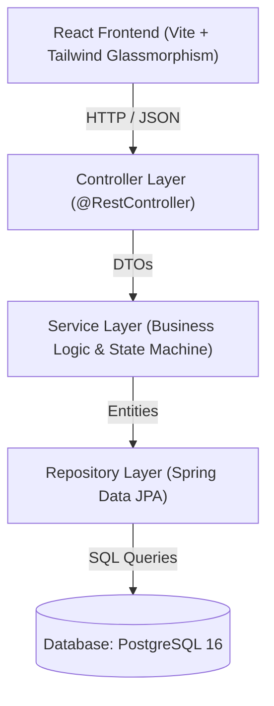
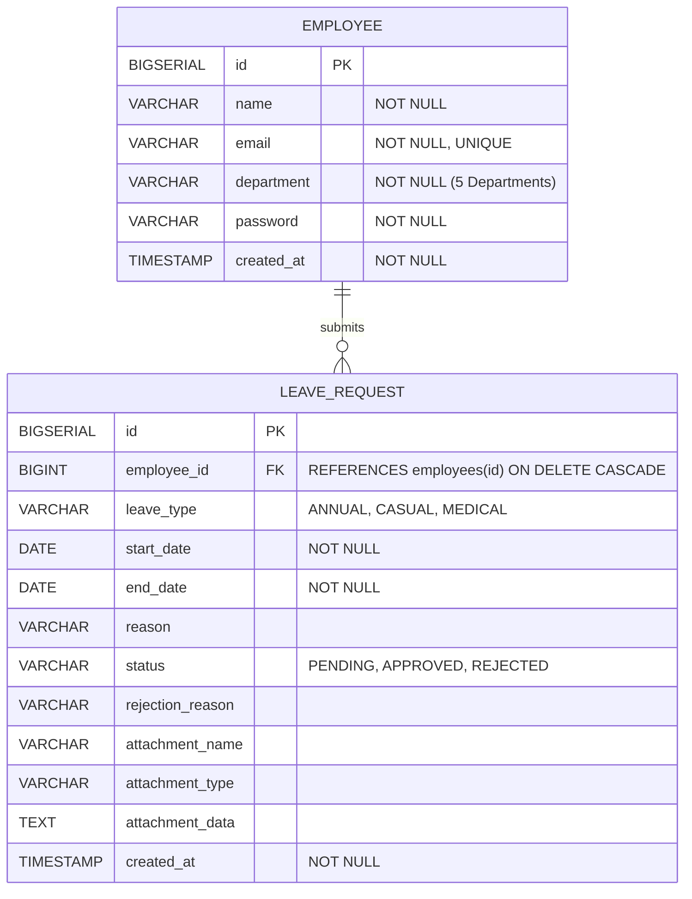

# Employee Leave Management System

A full-stack, enterprise-grade web application designed for managing employee leave applications and administrative workflows with modern Glassmorphism UI. Built as part of the Software Engineering Intern Technical Assessment for **Omibits (Pvt) Ltd.**

- **Repository:** `intern-leave-management-assignment`
- **Candidate:** Deshan Siriwardhana
- **Role:** Software Engineering Intern

---

## 🚀 Tech Stack

| Layer | Technologies | Justification |
| :--- | :--- | :--- |
| **Backend** | Java 21, Spring Boot 3.3.5 | Industry standard for enterprise REST APIs, strong type safety, Spring Data JPA, Jakarta Bean Validation. |
| **Frontend** | React 18, Vite, Tailwind CSS, Lucide Icons, Axios | Fast reactive Single Page Application (SPA), ultra-modern Glassmorphism UI, client-side validation. |
| **Database** | PostgreSQL 16 (Relational RDBMS) | Relational integrity with foreign key cascading and check constraints (`leave_management_db`). |
| **Testing** | JUnit 5, Mockito | High code quality and coverage for critical business rules and state machines (9/9 tests passing). |

---

## 📸 Application Screenshots

### 1. Workspace Sign-In
Interactive corporate login supporting Administrator privileges (`admin@omibits.com` / `admin123`) and Employee credentials.


### 2. Administrator Dashboard & Approvals
Overview metrics, pending review queue, quick approvals, rejection notes, and supporting document inspection.


### 3. Leave Application Form & Medical Proof Upload
Leave application form with instant date duration calculation, date validation, and supporting document / medical certificate attachment.


### 4. Employee Directory & 5 Corporate Departments
Employee management form with instant email validation, department selection across the 5 company departments, initial password assignment, and full edit/delete controls.


---

## 🏛️ System Architecture

The application adopts a clean **Layered Architecture (Tiered Architecture)** ensuring complete separation of concerns:



- **Controller Layer (`controller/`)**: Responsible solely for HTTP mapping, payload reception, invoking validation, and formatting standard JSON responses.
- **Service Layer (`service/`)**: Houses all business rules, date logic, state transition constraints, and entity transformations.
- **Repository Layer (`repository/`)**: Encapsulates database operations using Spring Data JPA.
- **DTO Layer (`dto/`)**: Decouples internal database entities from external API contracts to avoid over-exposure.
- **Exception Layer (`exception/`)**: Centralized `@RestControllerAdvice` converting exceptions into unified JSON error bodies (`ErrorResponse`).

---

## 🗄️ Database Design & Entity Relationships

The relational model enforces a strict **One-to-Many (1:N)** relationship between `Employee` and `LeaveRequest` with cascade deletion.

### Entity-Relationship Diagram



The exact SQL schema definition with check constraints and indexes is available in [`database/schema.sql`](database/schema.sql).

---

## 📋 REST API Endpoints

All endpoints use standard HTTP verbs and status codes:

| Method | Endpoint | Description | Request Body | Response Code |
| :--- | :--- | :--- | :--- | :--- |
| `POST` | `/api/auth/login` | Authenticate user (Admin / Employee) | `LoginRequest` JSON | `200 OK` |
| `POST` | `/api/employees` | Register new employee | `EmployeeRequest` JSON | `201 Created` |
| `GET` | `/api/employees` | List all employees | None | `200 OK` |
| `GET` | `/api/employees/{id}` | Get employee by ID | None | `200 OK` |
| `PUT` | `/api/employees/{id}` | Update employee details | `EmployeeRequest` JSON | `200 OK` |
| `DELETE` | `/api/employees/{id}` | Delete employee & cascade leaves | None | `204 No Content` |
| `POST` | `/api/leaves` | Submit leave request with attachment | `LeaveApplicationRequest` JSON | `201 Created` |
| `GET` | `/api/leaves` | List all leave requests | None | `200 OK` |
| `GET` | `/api/leaves/{id}` | Get leave request by ID | None | `200 OK` |
| `PUT` | `/api/leaves/{id}` | Edit pending leave request | `LeaveApplicationRequest` JSON | `200 OK` |
| `DELETE` | `/api/leaves/{id}` | Cancel/delete pending leave request | None | `204 No Content` |
| `PATCH` | `/api/leaves/{id}/approve` | Approve leave request | None | `200 OK` |
| `PATCH` | `/api/leaves/{id}/reject` | Reject leave request with justification | `RejectLeaveRequest` JSON | `200 OK` |

---

## 🔍 API Usage & Example Requests

### 1. Authenticate / Login
```bash
curl -X POST http://localhost:8080/api/auth/login \
  -H "Content-Type: application/json" \
  -d '{
    "email": "admin@omibits.com",
    "password": "admin"
  }'
```

### 2. Register Employee
```bash
curl -X POST http://localhost:8080/api/employees \
  -H "Content-Type: application/json" \
  -d '{
    "name": "Kamal Wickramasinghe",
    "email": "kamal@omibits.com",
    "department": "Engineering",
    "password": "password123"
  }'
```

### 3. Submit Leave Request (with optional attachment)
```bash
curl -X POST http://localhost:8080/api/leaves \
  -H "Content-Type: application/json" \
  -d '{
    "employeeId": 1,
    "leaveType": "MEDICAL",
    "startDate": "2026-11-01",
    "endDate": "2026-11-03",
    "reason": "Doctor advised rest after dental surgery",
    "attachmentName": "medical-slip.jpg",
    "attachmentType": "image/jpeg",
    "attachmentData": "data:image/jpeg;base64,..."
  }'
```

### 4. Approve Request
```bash
curl -X PATCH http://localhost:8080/api/leaves/1/approve
```

### 5. Reject Request (Requires Non-Empty Rejection Reason)
```bash
curl -X PATCH http://localhost:8080/api/leaves/1/reject \
  -H "Content-Type: application/json" \
  -d '{
    "rejectionReason": "Project sprint release falls within this date window. Please reschedule."
  }'
```

---

## 🧪 Unit & Integration Testing

The project contains unit tests implemented using **JUnit 5** and **Mockito** covering the required business constraints (9/9 passed):

1. **Email Duplicate Prevention:** Tests that attempting to register an employee with an existing email throws `InvalidOperationException`.
2. **Date Range Validation:** Tests that `endDate < startDate` fails with a descriptive validation exception.
3. **State Transition Integrity:** Tests that only `PENDING` leaves can be approved or rejected.
4. **Finalized Immutability:** Tests that already `APPROVED` or `REJECTED` requests cannot be altered.
5. **Mandatory Rejection Justification:** Tests that rejecting without a reason fails.

### Running Backend Tests:
```bash
cd backend
./mvnw test
```

---

## 🌿 Git Workflow & Branching Strategy

The repository follows a clean, feature-driven branching model adhering to industry Git Flow standards:

| Branch | Purpose / Scope |
| :--- | :--- |
| `main` | Production-ready stable release containing all integrated features, documentation, and tests. |
| `feature/backend-api-architecture` | Spring Boot 3 REST APIs, Layered Architecture, DTOs, Bean Validation, and JUnit 5 unit tests. |
| `feature/frontend-react-ui` | React 18 SPA with Tailwind Glassmorphism, Admin Dashboard, Leave Submissions, and responsive roster view. |
| `feature/database-postgres-schema` | PostgreSQL relational schema (`database/schema.sql`), check constraints, and TablePlus connection. |
| `feature/role-based-auth` | Corporate Sign-In, Role-Based Access Control (Admin vs. Employee), and user session management. |

---

## 💻 Local Setup & Execution Guide

### Prerequisites
- **Java 21** or later (`java -version`)
- **Node.js 18+** & npm (`node -v`, `npm -v`)
- **PostgreSQL 16** running locally on port 5432 (`leave_management_db`)
- Git

### 1. Clone the Repository
```bash
git clone https://github.com/deshan2004/intern-leave-management-assignment.git
cd intern-leave-management-assignment
```

### 2. Configure Database
Create a PostgreSQL database named `leave_management_db`:
```sql
CREATE DATABASE leave_management_db;
```
Configure your credentials in `backend/src/main/resources/application.properties` (Default: user `postgres`, password `postgres`, port `5432`). You can view live data with **TablePlus**.

### 3. Run Backend (Spring Boot)
```bash
cd backend
./mvnw spring-boot:run
```
- API Base URL: `http://localhost:8080`

### 4. Run Frontend (React + Vite)
In a new terminal window:
```bash
cd frontend
npm install
npm run dev
```
- Open browser at: **`http://localhost:5173`**

### 5. Default Credentials
- **System Administrator:** `admin@omibits.com` / `admin123`
- **Employee:** Any registered employee email & password (created via Admin Employee Directory).

---

## 🎯 Final Review & Technical Defense

Prepared explanations for the 5 technical review questions:

### 1. Why did you choose your database schema?
> **Answer:** 
> - A normalized relational model with a **1:N relationship** between `Employee` and `LeaveRequest` guarantees referential integrity via a Foreign Key (`employee_id`).
> - Separating employees from leave requests prevents data redundancy and anomalies.
> - Enumerated constraints (`CHECK (status IN (...))`, `CHECK (leave_type IN (...))`) and database-level date range checks (`CHECK (end_date >= start_date)`) enforce defensive data consistency at both application and database layers.
> - Adding `ON DELETE CASCADE` ensures that cleaning up an employee automatically purges child leave records without orphaned references.

### 2. How do you validate leave dates?
> **Answer:**
> - **Client-side (React):** Real-time feedback computes the calendar day duration between `startDate` and `endDate`. If `endDate < startDate`, an immediate alert is rendered and the submit button is disabled.
> - **Server-side (Spring Boot):** In `LeaveService.validateDateRange()`, before saving the record, `if (endDate.isBefore(startDate))` throws an `InvalidOperationException` returning HTTP 400 Bad Request.
> - **Database-level:** Enforced via SQL `CONSTRAINT chk_leave_dates CHECK (end_date >= start_date)`.

### 3. How do you prevent invalid status changes?
> **Answer:**
> - A finite state machine check is enforced in `LeaveService`:
>   ```java
>   if (leaveRequest.getStatus() != LeaveStatus.PENDING) {
>       throw new InvalidOperationException("Only PENDING requests can be approved or rejected.");
>   }
>   ```
> - Once a leave request reaches a terminal state (`APPROVED` or `REJECTED`), any subsequent call to `/approve` or `/reject` returns a 400 Bad Request with an explanation. On the frontend, action buttons are replaced with a "Decision finalized" badge.

### 4. How would you secure administrator operations?
> **Answer:**
> - Currently implemented via credential check in `AuthController` (`admin@omibits.com`) and UI role-based tab guards.
> - To secure this in a multi-tenant enterprise production environment:
>   1. Implement **Spring Security 6** with **JWT (JSON Web Tokens)** stored in HTTP-only Secure Cookies.
>   2. Define authorities: `ROLE_EMPLOYEE` and `ROLE_ADMIN`.
>   3. Protect endpoints with method-level security: `@PreAuthorize("hasRole('ADMIN')")` on `/api/leaves/{id}/approve` and `/api/leaves/{id}/reject`.
>   4. Protect employee submissions by extracting the `userId` directly from the authenticated SecurityContext principal rather than trusting the client payload.

### 5. What would you improve if you had one more day?
> **Answer:**
> 1. **Leave Balance & Quota Tracking:** Deduct approved days from annual/casual/medical balances (e.g. 14 annual, 7 casual days per year) and reject if balance is exceeded.
> 2. **Authentication & Authorization:** Full Spring Security with JWT and role-based login.
> 3. **Email Notifications:** Asynchronous event listener sending automated email notifications (via JavaMailSender) to employees when their leave is approved or rejected.
> 4. **Date Overlap Prevention:** Query to verify that an employee does not already have an approved or pending leave overlapping with the requested date range.
> 5. **Docker Compose:** Package backend, frontend, and PostgreSQL into a single `docker-compose.yml` for 1-click execution.
